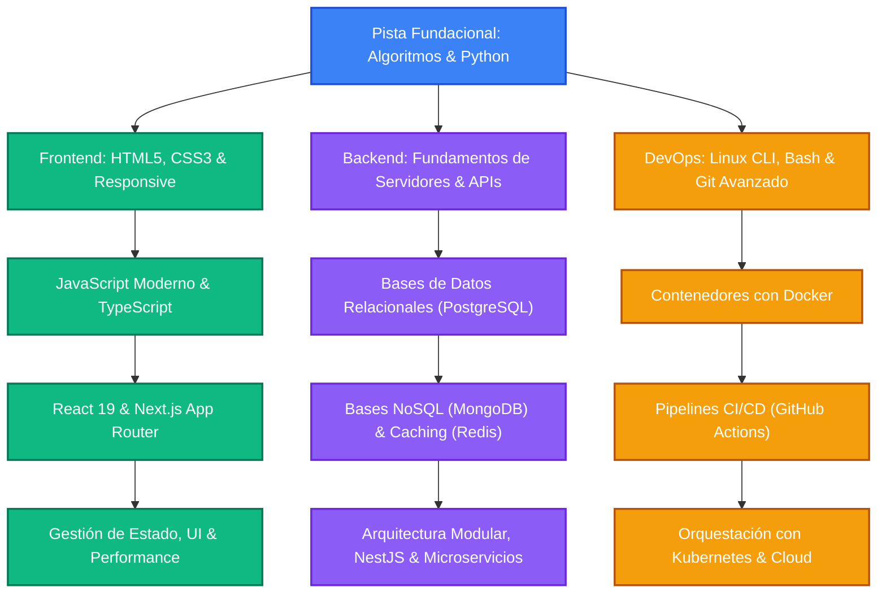

# 🦊 Koda — Duolingo de Programación

> Plataforma educativa interactiva y gamificada para aprender a programar desde cero, diseñada sin asunciones previas, sin fricción cognitiva, con micro-lecciones atómicas y un roadmap interactivo en grafo acíclico dirigido (DAG).

[](docs/adr/ADR-001-monorepo-pnpm-workspaces.md)
[-black.svg?logo=next.js)](apps/web)
[](apps/api)
[-emerald.svg)](docs/04-arquitectura-backend/12_DATABASE_DESIGN.md)
[](docs/adr/ADR-011-refinamiento-arquitectura-backend-eventos-persistencia-cache.md)
[](docs/adr/ADR-007-arquitectura-roadmap-ramas-carrera-grafo-dag.md)
[](docs/README.md)
[](LICENSE)

> [!IMPORTANT]
> ### ⚠️ Estado del Proyecto y Arquitectura Actual
> Koda cuenta con una arquitectura moderna formalizada bajo **11 Decisiones de Arquitectura (ADR-001 a ADR-011)**:
> - **Monorepo Operativo:** Next.js 15 (React 19, Turbopack, PixiJS v7) en `apps/web`, NestJS en `apps/api` y contratos TypeScript compartidos en `@koda/types`.
> - **Persistencia Híbrida Políglota:** Supabase (PostgreSQL 15+ ACID con RLS) para transacciones de usuarios, racha, progreso y cuaderno de errores; y **MongoDB 7+** para almacenamiento desacoplado de contenido educativo, currículos y grafos de carrera sin necesidad de JOINs relacionales costosos.
> - **Eventos Asíncronos Resilientes:** Procesamiento desacoplado mediante colas persistentes con **BullMQ** sobre Redis para XP, rachas, logros y emisión de certificados.
> - **Caché Inmutable Versionada:** Estrategia Cache-Aside en Redis con claves por versión de contenido (`koda:lesson:{slug}:v{version}`).
> - **Roadmap Interactivo en Grafo DAG:** Canvas navegable con Pan y Zoom (50% a 200%), selección de ramas profesionales y topología de rejilla relativa (`tier` y `lane`).

---

## 🎯 Visión y Filosofía Pedagógica de Koda

La mayoría de plataformas asumen conocimientos previos, emplean jerga intimidante o presentan muros de texto que provocan frustración y abandono temprano. **Koda** reimagina el aprendizaje combinando gamificación formativa, la ergonomía de herramientas modernas como Linear y VS Code, y los principios pedagógicos más rigurosos:

- **Micro-Lecciones Atómicas:** Cada lección consta de 40 a 70 palabras redactadas en segunda persona (*"tú"*), introduciendo un único concepto sin abstracciones inexplicadas.
- **Tríada Evaluativa por Lección (3 Ítems Formativos):**
  1. **Ítem 1 (Desafío de Consola / Código):** Escritura y ejecución de código interactivo evaluado mediante casos de prueba automatizados en tiempo real (Wasm con Pyodide en cliente o sandbox Docker seguro).
  2. **Ítem 2 (Pregunta Conceptual Teórica):** Selección múltiple con exactamente 4 opciones estructuradas (A, B, C, D) y retroalimentación pedagógica contextual por distractor.
  3. **Ítem 3 (Predicción de Salida / Bug Hunting):** Razonamiento lógico donde el estudiante debe predecir la salida de un fragmento o identificar un error de sintaxis/lógica.
- **Sistema de 1 a 3 Estrellas (⭐) por Desempeño:**
  - ⭐⭐⭐ **(3 Estrellas):** Los 3 ítems aprobados al primer intento (100% de precisión).
  - ⭐⭐ **(2 Estrellas):** 2 ítems aprobados al primer intento y 1 resuelto con apoyo formativo.
  - ⭐ **(1 Estrella):** 1 ítem aprobado al primer intento y superación tras el ciclo de reintentos.
- **Ronda de Repaso Final y Feedback sin Spoilers:** Al equivocarse, el estudiante recibe una pista inteligente pero **jamás la respuesta correcta**. Las preguntas falladas se encolan para la Ronda de Repaso Final con opciones barajadas aleatoriamente.
- **Cuaderno de Errores con Algoritmo SuperMemo SM-2:** Los fallos persistentes se guardan en el cuaderno personal (`user_mistakes_notebook`), donde el algoritmo de repetición espaciada **SM-2** programa repasos óptimos (`interval_days`, `ease_factor`, `next_review_at`) para consolidar la memoria a largo plazo.
- **Gamificación Formativa y No Punitiva:** Rachas diarias (`daily_streaks`), congeladores de racha para prevenir abandono, economía de XP determinista y animaciones reactivas de la mascota **🦊 Koda** en WebGL.

---

## 🏗️ Pila Tecnológica Oficial

```
┌──────────────────────────────────────────────────────────────────────────────┐
│                            ARQUITECTURA DE KODA                              │
├──────────────────────────────────────────────────────────────────────────────┤
│  Frontend (Next.js 15 App Router + React 19 + TypeScript)                    │
│  ├── Roadmap Interactivo: Canvas DAG con Pan & Zoom (50% - 200%)             │
│  │   └── Topología Relativa: Disposición por Tier y Lane con aristas Bezier  │
│  ├── UI & Estilos: Tailwind CSS + Shadcn UI + Lucide Icons                   │
│  ├── Estado & Server Cache: Zustand + TanStack Query                         │
│  ├── Editor & Consola: Monaco Editor / CodeMirror 6 + Pyodide (Wasm)         │
│  └── Motor Gráfico WebGL: PixiJS v7 (Mascota Koda 🦊, confeti y emociones)   │
├──────────────────────────────────────────────────────────────────────────────┤
│  Backend (NestJS Monolito Modular - Arquitectura Hexagonal / Puertos)         │
│  ├── Core API: REST /api/v1 + OpenAPI 3.0.3 (Swagger)                        │
│  ├── Autenticación Unificada: Supabase Auth IdP + JWT firmado compatible RLS │
│  ├── Motor de Eventos Asíncronos: BullMQ sobre Redis (XP, Streaks, Logros)   │
│  ├── Caché L2 Inmutable Versionada: Redis (koda:lesson:{slug}:v{version})    │
│  ├── Motor de Ejecución Híbrido (ICoderunner):                               │
│  │   ├── Cliente Wasm: Pyodide (Python), Web Workers (JavaScript)            │
│  │   └── Backend Sandbox: Piston / Judge0 aislado en Docker                  │
│  └── Motor de Certificación: Generación PDF vectorial + QR ISO/IEC 18004     │
├──────────────────────────────────────────────────────────────────────────────┤
│  Persistencia Híbrida Políglota & Almacenamiento                             │
│  ├── Transaccional ACID: Supabase (PostgreSQL 15+) con Row-Level Security    │
│  │   └── Usuarios, perfiles, compras, XP, racha, progreso y SM-2 Notebook   │
│  ├── Contenido & Grafos Curriculares: MongoDB 7+ (Lecturas O(1) sin JOINs)   │
│  │   └── Ramas de carrera, nodos DAG, lecciones con tríada y animaciones     │
│  ├── Storage de Certificados: Google Drive API v3 (Service Account)          │
│  │   └── Deduplicación por hash SHA-256 y streaming directo                  │
│  └── Caché & Message Broker: Redis 7+                                        │
└──────────────────────────────────────────────────────────────────────────────┘
```

---

## 🗺️ Mapa Curricular: 3 Ramas Profesionales en Grafo DAG

Koda supera el modelo de currículo puramente lineal mediante un **Grafo Acíclico Dirigido (DAG)** interactivo. Los estudiantes inician en una pista fundacional común y desbloquean trayectorias de especialización técnica:



### Topología de Rejilla Relativa (`tier` y `lane`)
Para garantizar un lienzo interactivo fluido y responsive en cualquier resolución de pantalla, Koda sustituyó las coordenadas rígidas en píxeles por una **topología relativa de rejilla matricial** (`ADR-011`):
- **`tier` (Fila / Nivel de Profundidad):** Determina la progresión pedagógica vertical ($0, 1, 2 \dots N$). Los nodos en un tier superior dependen conceptualmente de los tiers previos.
- **`lane` (Columna / Desplazamiento Horizontal):** Organiza especializaciones y bifurcaciones paralelas (ej. $-2$: DevOps, $0$: Núcleo/Backend, $+2$: Frontend).
- **Aristas Paramétricas y Efectos Visuales:** Las dependencias entre nodos (`requires`, `unlocks`) se renderizan como curvas de Bézier dinámicas con soporte para estilos visuales (`laser-flow-fast`, `energy-beam`, `pulse-glow`, `dotted-amber`).

---

## 💻 Experiencia de Aprendizaje y Workspace Desktop

El entorno de lección divide la pantalla en un formato **50/50 split** balanceado ergonómicamente para programar y reflexionar simultáneamente:

```
┌─────────────────┬────────────────────────────────────────────────────────────────────────┐
│     🦊 KODA     │ 🧭 Backend › Módulo 02 › Lección 04: Conexión con PostgreSQL [ ⭐⭐⭐ ]  │
├─────────────────┼────────────────────────────────────────────────────────────────────────┤
│ 🗺️ Roadmap DAG  │ ┌── STEPPER DE LECCIÓN ──────────────────────────────────────────────┐ │
│ 📖 Lección (*)  │ │ Ítem 1: Código [✓]  │  Ítem 2: Quiz [●]  │  Ítem 3: Predicción [ ]   │ │
│ 📓 Cuaderno     │ └────────────────────────────────────────────────────────────────────┘ │
│ 🏆 Logros       │ ┌───────────────────────────────┐ ┌──────────────────────────────────┐ │
│ 📜 Certificados │ │ 📖 TEORÍA & EDITOR (Izq 50%)  │ │ 🧠 TRÍADA EVALUATIVA (Der 50%)   │ │
│                 │ │ • Explicación atómica (60 pal)│ │ • Ítem Activo: Quiz Conceptual   │ │
│ [🦊 Koda WebGL] │ │ • Editor con resaltado syntax │ │ • [A] Opción 1       (tecla 1)   │ │
│                 │ │ • Consola interactiva en vivo │ │ • [B] Opción 2       (tecla 2)   │ │
│                 │ │ • Casos de prueba automáticos │ │ • [C] Opción 3       (tecla 3)   │ │
│                 │ │                               │ │ • [D] Opción 4       (tecla 4)   │ │
│                 │ │ [ ▶ Ejecutar Código (Ctrl+↵) ]│ │ [ Comprobar Respuesta (Enter) ]  │ │
│                 │ └───────────────────────────────┘ └──────────────────────────────────┘ │
└─────────────────┴────────────────────────────────────────────────────────────────────────┘
```

### Características Principales del Workspace:
- **Flujo Progresivo en 3 Etapas:** Cada micro-lección valida la competencia práctica (código), conceptual (quiz de 4 opciones) y analítica (predicción/depuración) antes de otorgar estrellas.
- **Atajos de Teclado Productivos:** `1`-`4` o `A`-`D` para seleccionar opciones, `Ctrl + Enter` para compilar/ejecutar y `Enter` para verificar respuestas.
- **Mascota 🦊 Koda en WebGL (PixiJS v7):** Renderizado acelerado por GPU con animaciones dinámicas según el éxito de las respuestas, racha activa y eventos especiales.

---

## 📂 Estructura del Repositorio

El proyecto está organizado como un monorepo administrado con **pnpm workspaces**:

```
DuolingoProgramacion/
├── apps/                               # Aplicaciones ejecutables
│   ├── api/                            # Backend NestJS (REST API v2, BullMQ, Swagger)
│   └── web/                            # Frontend Next.js 15 (React 19, Canvas DAG, PixiJS)
├── packages/                           # Paquetes y contratos compartidos
│   └── types/                          # Contratos TypeScript oficiales (@koda/types)
├── content/                            # Cursos declarativos y semillas pedagógicas
│   ├── languages/                      # Rutas por lenguaje (Python, JS, etc.)
│   └── careers/                        # Estructura de carreras y grafos DAG
├── docs/                               # Hub de Documentación Técnica Modular
│   ├── README.md                       # Índice maestro y mapa de navegación
│   ├── adr/                            # Decisiones de Arquitectura (ADR-001 a ADR-011)
│   ├── 01-producto-negocio/            # Visión, alcance, monetización y roadmap
│   ├── 02-requisitos-ux/               # Requisitos RF/RNF, historias de usuario y UI/UX
│   ├── 03-pedagogia-contenido/         # Learning system, SM-2, quizzes y especificaciones
│   ├── 04-arquitectura-backend/        # Arquitectura modular, persistencia híbrida y API
│   └── 05-devops-seguridad/            # STRIDE, seguridad, pruebas y despliegue
├── documentation/                      # Gestión de proyecto y bitácora
│   ├── UserHistories/                  # Historias de usuario detalladas (Jira-ready)
│   └── changelog/                      # Bitácora diaria de cambios por fecha
├── CONTRIBUTING.md                     # Guía de contribución y convenciones
├── LICENSE                             # Licencia de código abierto MIT
└── README.md                           # Visión general del proyecto
```

---

## 🛠️ Inicio Rápido en Desarrollo Local

Para levantar el entorno completo de desarrollo:

### 1. Requisitos Previos
- **Node.js** `>= 20.0.0`
- **pnpm** `>= 9.0.0` (`npm i -g pnpm`)
- **Docker & Docker Compose** (para PostgreSQL, MongoDB y Redis locales)

### 2. Instalación y Compilación de Contratos
```bash
# 1. Clonar el repositorio
git clone https://github.com/nastex123/DuolingoProgramacion.git
cd DuolingoProgramacion

# 2. Instalar dependencias de todo el monorepo
pnpm install

# 3. Compilar el paquete de tipos compartidos
pnpm --filter "@koda/types" build
```

### 3. Configuración de Variables de Entorno
Copia los archivos `.env.example` en `apps/api` y `apps/web`:
```bash
cp apps/api/.env.example apps/api/.env
cp apps/web/.env.example apps/web/.env
```

Variables clave requeridas:
- `apps/api/.env`: `DATABASE_URL` (Supabase PostgreSQL), `MONGODB_URI` (MongoDB 7+), `REDIS_HOST` & `REDIS_PORT`, `SUPABASE_JWT_SECRET`.
- `apps/web/.env`: `NEXT_PUBLIC_API_URL` (por defecto `http://localhost:4000/api/v1`).

### 4. Ejecución de Servicios
```bash
# Iniciar frontend y backend en paralelo
pnpm dev

# O iniciar servicios de forma individual:
pnpm dev:web    # Next.js 15 en http://localhost:3000
pnpm dev:api    # NestJS API en http://localhost:4000
```

- 🌐 **Frontend Web:** [http://localhost:3000](http://localhost:3000)
- ⚙️ **Backend REST API:** [http://localhost:4000/api/v1](http://localhost:4000/api/v1)
- 📚 **Documentación Swagger / OpenAPI:** [http://localhost:4000/api/docs](http://localhost:4000/api/docs)

---

## 🤝 Contribuciones y Estándares

Las contribuciones son bienvenidas y deben respetar los estándares arquitectónicos del proyecto:
1. Toda nueva característica debe apegarse a los contratos TypeScript de `@koda/types`.
2. Las decisiones arquitectónicas estructurales deben formalizarse mediante un nuevo **ADR** en [`docs/adr/`](docs/adr/).
3. Todo cambio en el código o la documentación debe registrarse en la bitácora diaria correspondiente en [`documentation/changelog/`](documentation/changelog/).
4. Consulta [`CONTRIBUTING.md`](CONTRIBUTING.md) para más detalles sobre ramas y mensajes de commit convencionales.

---

## 📜 Licencia

Este proyecto está bajo la Licencia **MIT**. Consulta el archivo [`LICENSE`](LICENSE) para mayores detalles.
