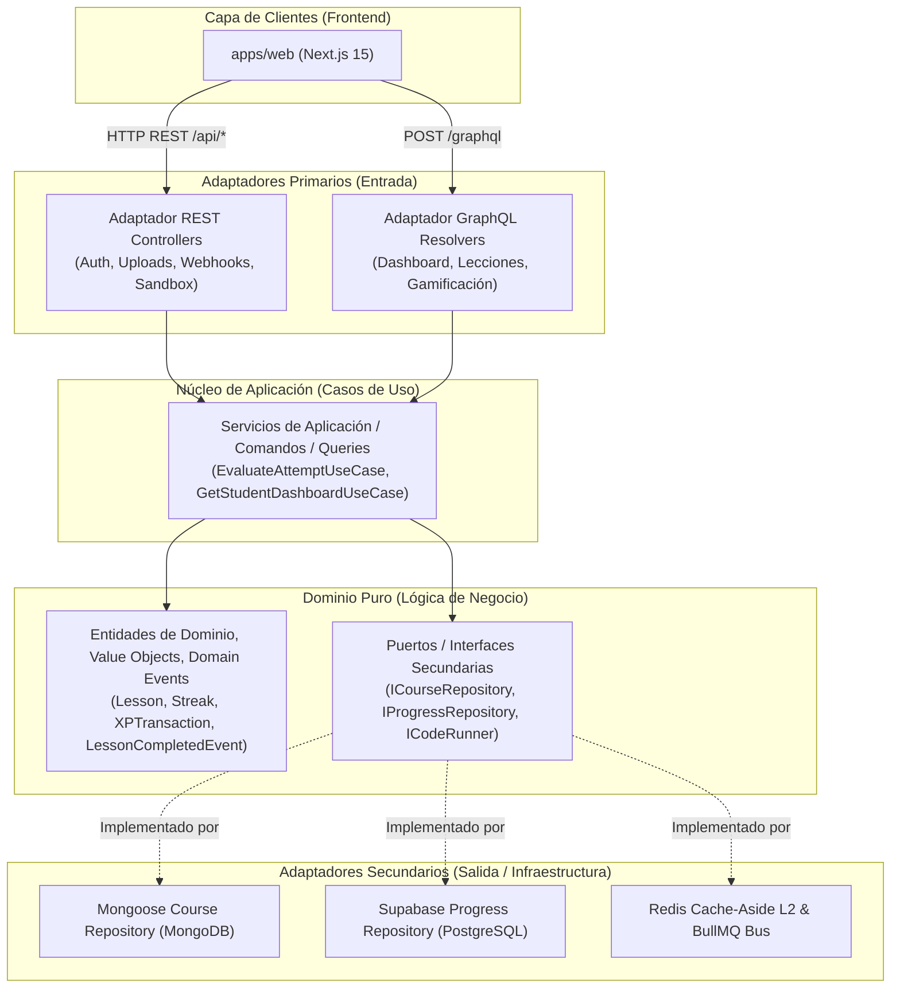

# Comparativa de Arquitectura Backend: Modular Nativa de NestJS vs. Monolito Hexagonal basado en EDD

> **Documento de Decisión y Análisis Técnico — Koda 🦊**  
> **Fecha:** 2026-09-14  
> **Autores:** Daniel Echeverría & Equipo de Arquitectura Koda  
> **Trazabilidad:** `ADR-008`, `ADR-009`, `ADR-010`, `ADR-011`, `ADR-012`, `11_SYSTEM_ARCHITECTURE.md`, `RNF-001`, `RNF-010`, `RNF-030`  

---

## 1. Integración de GraphQL en la Arquitectura Definida

Con la adopción de la arquitectura híbrida formalizada en el **ADR-012**, GraphQL no compite ni altera la arquitectura interna del backend, sino que encaja de forma natural como un **Adaptador Primario de Entrada (Driving Adapter)** dentro del patrón de **Puertos y Adaptadores (Arquitectura Hexagonal)**.



> **Principio de Aislamiento:**  
> La capa de aplicación y el dominio de negocio **no tienen conocimiento** del medio de transporte utilizado. Tanto un controlador REST (`@Controller()`) como un resolver GraphQL (`@Resolver()`) son adaptadores intercambiables que transforman peticiones externas en comandos o consultas de aplicación.

---

## 2. Definición de las Alternativas de Arquitectura

### Alternativa A: Arquitectura Modular Nativa de NestJS (Layered / Convencional)
Es el patrón promovido por defecto en la documentación oficial de NestJS:
* **Organización:** Carpetas agrupadas por módulo o entidad (`users/`, `courses/`, `lessons/`, `gamification/`), donde cada una incluye directamente `*.module.ts`, `*.controller.ts`, `*.service.ts`, `*.dto.ts` y esquemas ORM/ODM (`*.schema.ts`).
* **Comunicación Inter-módulos:** Inyección de dependencias directa y síncrona. Si `ProgressService` necesita sumar experiencia o actualizar rachas, importa `GamificationModule` e inyecta directamente `GamificationService`.
* **Acoplamiento de Persistencia:** Los servicios contienen lógica de negocio mezclada con llamadas directas a Mongoose (`@InjectModel()`) o clientes de base de datos relacional.

### Alternativa B: Monolito Hexagonal basado en EDD (Event-Driven Design)
Es el modelo definido formalmente en **ADR-010** y refinado en **ADR-011**:
* **Organización (Ports & Adapters):** Cada Bounded Context divide sus capas en:
  * `domain/`: Entidades puras, reglas invariantes de negocio, eventos de dominio e interfaces de puertos (`ICourseRepository`, `IProgressRepository`). Sin decoradores de frameworks ni librerías de persistencia.
  * `application/`: Casos de uso que orquestan el flujo de negocio y publican eventos.
  * `infrastructure/`: Implementaciones concretas de puertos (controladores REST/GraphQL, repositorios Mongoose, clientes Supabase, workers BullMQ).
* **Comunicación Asíncrona Orientada a Eventos (EDD):** Desacoplamiento total de efectos secundarios. Al finalizar una lección, el caso de uso persiste el intento y emite un `LessonCompletedEvent` (mediante `@nestjs/event-emitter` o persistido en `BullMQ`). Los módulos de Gamificación, Rachas, Logros y Estadísticas reaccionan como *listeners* independientes.
* **Persistencia Abstraída:** La lógica de negocio depende exclusivamente de interfaces de puertos TypeScript, aislando la complejidad políglota (MongoDB vs. PostgreSQL).

---

## 3. Cuadro Comparativo Exhaustivo

| Criterio | Modular Nativa de NestJS | Monolito Hexagonal basado en EDD | Impacto Específico en Koda |
| :--- | :--- | :--- | :--- |
| **Curva y Velocidad Inicial** | **Muy rápida.** Menos archivos, estructura intuitiva para desarrolladores que inician en NestJS. | **Media a inicial lenta.** Requiere diseñar entidades puras, interfaces de puertos y adaptadores independientes. | El desarrollo inicial es más directo en la nativa, pero genera deuda técnica a mediano plazo en sistemas gamificados complejos. |
| **Riesgo de Dependencias Circulares (`RNF-030`)** | **Muy Alto.** La interacción cruzada (*Progreso $\leftrightarrow$ Gamificación $\leftrightarrow$ Rachas $\leftrightarrow$ Notificaciones*) fuerza el uso de `forwardRef()` y acopla módulos fuertemente. | **Nulo.** Los módulos emisores publican eventos y desconocen por completo qué módulos consumen dichos eventos. | **Crítico:** Koda requiere desacoplamiento estricto para evitar bloqueos cíclicos de inyección en NestJS. |
| **Latencia de Respuesta HTTP (`RNF-010`)** | **Acumulativa y bloqueante.** El endpoint espera secuencialmente el cálculo de XP, subida de nivel, racha y escrituras en base de datos ($> 200\text{ ms}$). | **Garantizada ($p95 < 50\text{ ms}$).** Persistencia del intento nuclear y despacho inmediato de eventos asíncronos a workers; retorno instantáneo al alumno. | **Crítico:** La experiencia interactiva gamificada tipo Duolingo exige feedback en menos de 50 ms tras responder un reactivo. |
| **Persistencia Híbrida Políglota (`ADR-009`)** | Tiende a acoplar modelos de Mongoose y queries de Supabase en un mismo servicio, violando la responsabilidad única. | Los puertos (`ICurriculumRepository`, `IUserProgressRepository`) encapsulan completamente la tecnología de base de datos subyacente. | **Esencial:** Koda utiliza MongoDB para contenido/árbol pedagógico y PostgreSQL (Supabase) para usuarios y transacciones. |
| **Testabilidad Unitaria** | Compleja; requiere mockear clases de framework (`Model<UserDocument>`, `NestJS ModuleRef`). | **Excelente:** El dominio y los casos de uso se prueban de forma 100% pura pasando objetos o mocks de interfaces TypeScript. | Facilita una cobertura de pruebas unitarias robusta y rápida sin levantar bases de datos ni Docker. |
| **Evolución hacia Microservicios / Workers** | Difícil y costosa; requiere reescribir inyecciones de dependencias y refactorizar métodos acoplados. | **Trivial:** Los listeners de eventos y los adaptadores de infraestructura pueden extraerse a workers o servicios independientes sin tocar el dominio. | Permite a Koda escalar horizontalmente procesos pesados (certificados en PDF, cálculo de ligas) sin reingeniería. |

---

## 4. Análisis del Escenario Real de Koda

### 1. El Efecto Dominó de la Gamificación
En Koda, el evento `POST /api/v1/lessons/:id/complete` o la mutación `submitLessonAnswer` no es un simple CRUD. Detona una reacción en cadena:
1. Validación y verificación determinista del código en backend.
2. Cálculo de estrellas obtenidas (1 a 3 estrellas según la tríada evaluativa).
3. Recálculo y salvaguarda de la racha diaria (*Streak Freeze* / algoritmos de gracia).
4. Otorgamiento de XP, aplicación de multiplicadores temporales y verificación de ascenso de nivel.
5. Verificación de compuertas DAG desbloqueadas en la ruta de carrera.
6. Actualización de posiciones en la tabla de clasificación semanal (*Leaderboard*).

Si este flujo se implementa mediante la **Modular Nativa con llamadas síncronas directas**:
- Un fallo o lentitud en el cálculo del leaderboard abortará o congelará la finalización de la lección del alumno.
- El tiempo de respuesta excederá los umbrales de latencia móvil.

### 2. La Persistencia Políglota
Al tener el currículo en MongoDB y el progreso en PostgreSQL (Supabase), un servicio modular clásico que consuma ambos esquemas quedará rígidamente atado a las particularidades de Mongoose y TypeORM/Supabase-JS. Si el día de mañana se optimiza el almacenamiento de lecciones o se introduce caché en memoria, el cambio impactará directamente la lógica de aprendizaje.

---

## 5. Recomendación y Veredicto Técnico: "Hexagonal Pragmático"

No se aconseja caer en una sobrediseñada burocracia de código (crear 10 archivos y capas de mappers para un CRUD administrativo básico de solo lectura), pero **se ratifica la vigencia y necesidad del Monolito Hexagonal basado en EDD para los motores centrales de Koda**:

```
                                  KODA BACKEND
                                       │
        ┌──────────────────────────────┴──────────────────────────────┐
        ▼                                                             ▼
[ NÚCLEO EDUCATIVO & GAMIFICACIÓN ]                      [ MÓDULOS DE SOPORTE & ADMIN ]
• Arquitectura Hexagonal Estricta                       • Modular NestJS Estándar
• Puertos e Interfaces Desacopladas                     • Controllers y Services directos
• Comunicación Asíncrona con BullMQ / Events            • Lógica CRUD simple
• Persistencia Políglota encapsulada                    • Mongoose / Supabase directo
• Garantía de latencia p95 < 50 ms                      • Menor sobrecarga de boilerplate
```

### Directrices de Aplicación:

1. **Módulos con Hexagonal + EDD (Innegociable):**
   - **`learning` / `courses`:** Gestión de currículo, DAG y evaluación de código.
   - **`progress` / `evaluation`:** Registro de intentos y lecciones completadas.
   - **`gamification`:** Rachas, XP, ligas, niveles e inventario de gemas.
   - **`certification`:** Emisión asíncrona de diplomas mediante colas de segundo plano.

2. **Módulos con Arquitectura Modular Convencional (Pragmático):**
   - **`auth`:** Autenticación e integración con Supabase GoTrue / JWT.
   - **`admin`:** Operaciones de gestión interna, métricas operativas y catálogo de activos cosméticos.
   - **`health`:** Monitoreo y telemetría de infraestructura.

### Conclusión
El Monolito Hexagonal basado en EDD no es un capricho teórico; es la respuesta arquitectónica precisa para satisfacer los requerimientos no funcionales de Koda (**RNF-010: Latencia**, **RNF-030: Cero Dependencias Circulares** y **ADR-009: Persistencia Políglota**), mientras que la arquitectura híbrida con GraphQL y REST (ADR-012) provee la interfaz óptima para cada caso de uso.
