# 📚 Índice Maestro y Hub de Documentación — Koda 🦊

> Guía central de navegación para la arquitectura, diseño pedagógico, APIs, modelo de datos y operaciones de la plataforma educativa **Koda (Duolingo de Programación)**.

---

## 🗺️ Mapa General de Especificaciones

La documentación técnica de Koda se organiza en **5 dominios funcionales modulares** y un repositorio central de **Decisiones de Arquitectura (ADRs)**:

```mermaid
graph LR
    subgraph D1["1. Producto & Negocio"]
        P1["01 Visión General"]
        P2["02 Problema"]
        P3["03 Objetivos"]
        P4["04 Alcance"]
        P5["18 Monetización"]
        P6["22 Roadmap"]
    end

    subgraph D2["2. Requisitos & UI/UX"]
        U1["05 Requisitos Funcionales"]
        U2["06 Requisitos No Funcionales"]
        U3["07 Historias de Usuario"]
        U4["08 Casos de Uso"]
        U5["09 Flujos de Usuario"]
        U6["10 Arquitectura Info"]
        U7["27 Especificación UI/UX"]
    end

    subgraph D3["3. Pedagogía & Contenido"]
        C1["14 Learning System"]
        C2["15 Quiz & Exámenes"]
        C3["16 Gamificación"]
        C4["23 Content Spec"]
        C5["24 Content Authoring"]
    end

    subgraph D4["4. Arquitectura & Backend"]
        A1["11 System Architecture"]
        A2["12 Database Design"]
        A3["13 API REST Spec"]
        A4["17 Certificación"]
        A5["25 Admin System"]
        ADR["ADRs (docs/adr/)"]
    end

    subgraph D5["5. Seguridad & DevOps"]
        S1["19 Seguridad & STRIDE"]
        S2["20 Testing Strategy"]
        S3["21 Despliegue & Cloud"]
        S4["26 Analítica & Métricas"]
    end

    D1 --> D2
    D2 --> D3
    D3 --> D4
    D4 --> D5
```

---

## 🧭 Rutas de Lectura Recomendadas por Rol

Para optimizar el tiempo de incorporación al proyecto (*onboarding*), consulta los documentos en el siguiente orden según tu especialidad:

### 💻 Frontend Developer (Next.js 15, PixiJS, Tailwind)
1. [`01_PROJECT_OVERVIEW.md`](01-producto-negocio/01_PROJECT_OVERVIEW.md) — Visión del producto y filosofía pedagógica.
2. [`27_UI_UX_SPECIFICATION.md`](02-requisitos-ux/27_UI_UX_SPECIFICATION.md) — Sistema de diseño, layout 50/50 split, atajos y Koda WebGL.
3. [`10_INFORMATION_ARCHITECTURE.md`](02-requisitos-ux/10_INFORMATION_ARCHITECTURE.md) — Pantallas S-01 a S-32 y flujos de navegación.
4. [`13_API_SPECIFICATION.md`](04-arquitectura-backend/13_API_SPECIFICATION.md) — Contratos REST v2.0 para consumo de datos.
5. [`packages/types/README.md`](../packages/types/README.md) — Modelos compartidos `@koda/types`.
6. [`apps/web/README.md`](../apps/web/README.md) — Configuración del frontend, Zustand y PixiJS.

### ⚙️ Backend Developer (NestJS, Supabase PostgreSQL, MongoDB)
1. [`01_PROJECT_OVERVIEW.md`](01-producto-negocio/01_PROJECT_OVERVIEW.md) — Principios del sistema y reglas de negocio.
2. [`11_SYSTEM_ARCHITECTURE.md`](04-arquitectura-backend/11_SYSTEM_ARCHITECTURE.md) — Arquitectura modular NestJS (`ADR-008`), motores y dependencias.
3. [`12_DATABASE_DESIGN.md`](04-arquitectura-backend/12_DATABASE_DESIGN.md) — Persistencia híbrida (`ADR-009`): Supabase PostgreSQL (transacciones) + MongoDB (contenido).
4. [`13_API_SPECIFICATION.md`](04-arquitectura-backend/13_API_SPECIFICATION.md) — Endpoints OpenAPI 3.0.3, DTOs y respuestas.
5. [`17_CERTIFICATION.md`](04-arquitectura-backend/17_CERTIFICATION.md) — Emisión de certificados con Google Drive Service Account (`ADR-003`).
6. [`docs/adr/`](adr/README.md) — Decisiones de arquitectura formalizadas (ADR-001 a ADR-009).
7. [`apps/api/README.md`](../apps/api/README.md) — Estructura NestJS, controladores y Swagger.

### ✍️ Diseñador Instruccional / Creador de Contenido (Python & Tracks)
1. [`01_PROJECT_OVERVIEW.md`](01-producto-negocio/01_PROJECT_OVERVIEW.md) — Filosofía de micro-lecciones atómicas (40-70 palabras, sin spoilers).
2. [`24_CONTENT_AUTHORING_GUIDE.md`](03-pedagogia-contenido/24_CONTENT_AUTHORING_GUIDE.md) — Plantillas de redacción, taxonomía de distractores y feedback formativo.
3. [`23_CONTENT_SPECIFICATION.md`](03-pedagogia-contenido/23_CONTENT_SPECIFICATION.md) — Estructura JSON y validación contra esquema declarativo.
4. [`content/README.md`](../content/README.md) — Estructura de carpetas y cursos declarativos.

### 🚀 DevOps, Cloud & QA Engineer
1. [`06_NON_FUNCTIONAL_REQUIREMENTS.md`](02-requisitos-ux/06_NON_FUNCTIONAL_REQUIREMENTS.md) — RNF-001 a RNF-045 (latencia, concurrencia, disponibilidad).
2. [`19_SECURITY.md`](05-devops-seguridad/19_SECURITY.md) — STRIDE, JWT rotativo, rate limiting y anonimización PII.
3. [`20_TESTING.md`](05-devops-seguridad/20_TESTING.md) — Pirámide de pruebas, casos normativos TC-001 a TC-032.
4. [`21_DEPLOYMENT.md`](05-devops-seguridad/21_DEPLOYMENT.md) — Contenedores Docker, CI/CD GitHub Actions y entornos.
5. [`26_ANALYTICS.md`](05-devops-seguridad/26_ANALYTICS.md) — Eventos de analítica y métricas M-01 a M-16.

---

## 📑 Catálogo Modular de Especificaciones

### 💼 [Dominio 1 — Producto & Negocio](01-producto-negocio/README.md)
| Código | Documento | Versión | Estado | Descripción Principal |
|:---:|---|:---:|:---:|---|
| **01** | [`01_PROJECT_OVERVIEW.md`](01-producto-negocio/01_PROJECT_OVERVIEW.md) | 2.0.0 | ✅ Aprobado | Propósito, modelo pedagógico atómico y alcance del producto Koda. |
| **02** | [`02_PROBLEM_STATEMENT.md`](01-producto-negocio/02_PROBLEM_STATEMENT.md) | 1.0.0 | ✅ Aprobado | Análisis del problema educativo, frustración y abandono en programación. |
| **03** | [`03_OBJECTIVES.md`](01-producto-negocio/03_OBJECTIVES.md) | 1.0.0 | ✅ Aprobado | Objetivos estratégicos (OE), técnicos (OT) y de experiencia (OUX). |
| **04** | [`04_SCOPE.md`](01-producto-negocio/04_SCOPE.md) | 1.1.0 | ✅ Aprobado | Delimitación estricta de alcance: IN SCOPE (MVP) vs. Post-MVP. |
| **18** | [`18_MONETIZATION.md`](01-producto-negocio/18_MONETIZATION.md) | 1.0.0 | ✅ Aprobado | Modelo de negocio: plan gratuito con anuncios no intrusivos y Premium USD $1. |
| **22** | [`22_ROADMAP.md`](01-producto-negocio/22_ROADMAP.md) | 1.1.0 | ✅ Aprobado | Fases de desarrollo (0 a 10), Definition of Done y priorización MVP. |

### 🎨 [Dominio 2 — Requisitos & UI/UX](02-requisitos-ux/README.md)
| Código | Documento | Versión | Estado | Descripción Principal |
|:---:|---|:---:|:---:|---|
| **05** | [`05_FUNCTIONAL_REQUIREMENTS.md`](02-requisitos-ux/05_FUNCTIONAL_REQUIREMENTS.md) | 1.1.0 | ✅ Aprobado | Matriz de 128 requisitos funcionales (`RF-*`) con trazabilidad a UC. |
| **06** | [`06_NON_FUNCTIONAL_REQUIREMENTS.md`](02-requisitos-ux/06_NON_FUNCTIONAL_REQUIREMENTS.md) | 1.0.0 | ✅ Aprobado | 45 requisitos no funcionales (`RNF-*`): rendimiento, seguridad y accesibilidad. |
| **07** | [`07_USER_STORIES.md`](02-requisitos-ux/07_USER_STORIES.md) | 1.0.0 | ✅ Aprobado | Historias de usuario maestras vinculadas al backlog en `documentation/UserHistories/`. |
| **08** | [`08_USE_CASES.md`](02-requisitos-ux/08_USE_CASES.md) | 1.0.0 | ✅ Aprobado | Casos de uso formales con precondiciones, flujos principal y alternativos. |
| **09** | [`09_USER_FLOWS.md`](02-requisitos-ux/09_USER_FLOWS.md) | 1.0.0 | ✅ Aprobado | 15 diagramas de flujo completos (F-01 a F-15) en Mermaid. |
| **10** | [`10_INFORMATION_ARCHITECTURE.md`](02-requisitos-ux/10_INFORMATION_ARCHITECTURE.md) | 1.0.0 | ✅ Aprobado | Mapa de sitio (pantallas S-01 a S-32) y jerarquía de navegación. |
| **27** | [`27_UI_UX_SPECIFICATION.md`](02-requisitos-ux/27_UI_UX_SPECIFICATION.md) | 1.1.0 | ✅ Aprobado | Design System, split-screen 50/50, animaciones PixiJS Koda y atajos de teclado. |

### 🧠 [Dominio 3 — Pedagogía & Contenido](03-pedagogia-contenido/README.md)
| Código | Documento | Versión | Estado | Descripción Principal |
|:---:|---|:---:|:---:|---|
| **14** | [`14_LEARNING_SYSTEM.md`](03-pedagogia-contenido/14_LEARNING_SYSTEM.md) | 1.0.0 | ✅ Aprobado | Máquinas de estado pedagógicas, algoritmo de repaso y adaptatividad. |
| **15** | [`15_QUIZ_EXAM_SYSTEM.md`](03-pedagogia-contenido/15_QUIZ_EXAM_SYSTEM.md) | 1.0.0 | ✅ Aprobado | Reglas de composición de quizzes, exámenes y criterios de aprobación ($\ge 80\%$). |
| **16** | [`16_GAMIFICATION.md`](03-pedagogia-contenido/16_GAMIFICATION.md) | 1.1.0 | ✅ Aprobado | Economía de XP, fórmula de nivel, rachas diarias, estrellas y logros. |
| **23** | [`23_CONTENT_SPECIFICATION.md`](03-pedagogia-contenido/23_CONTENT_SPECIFICATION.md) | 1.0.0 | ✅ Aprobado | Especificación técnica declarativa JSON Schema para cursos independientes. |
| **24** | [`24_CONTENT_AUTHORING_GUIDE.md`](03-pedagogia-contenido/24_CONTENT_AUTHORING_GUIDE.md) | 1.0.0 | ✅ Aprobado | Manual de estilo editorial, pedagogía de micro-lecciones y feedback sin spoilers. |

### ⚙️ [Dominio 4 — Arquitectura & Backend](04-arquitectura-backend/README.md)
| Código | Documento | Versión | Estado | Descripción Principal |
|:---:|---|:---:|:---:|---|
| **11** | [`11_SYSTEM_ARCHITECTURE.md`](04-arquitectura-backend/11_SYSTEM_ARCHITECTURE.md) | 2.1.0 | ✅ Aprobado | Arquitectura técnica modular: Next.js 15 + NestJS (`ADR-008`) + Supabase + MongoDB (`ADR-009`). |
| **12** | [`12_DATABASE_DESIGN.md`](04-arquitectura-backend/12_DATABASE_DESIGN.md) | 3.0.0 | ✅ Aprobado | Persistencia híbrida políglota: Supabase (PostgreSQL 15+) transaccional + MongoDB para contenido. |
| **13** | [`13_API_SPECIFICATION.md`](04-arquitectura-backend/13_API_SPECIFICATION.md) | 2.1.0 | ✅ Aprobado | Especificación REST OpenAPI 3.0.3 (endpoints, DTOs y códigos de error). |
| **17** | [`17_CERTIFICATION.md`](04-arquitectura-backend/17_CERTIFICATION.md) | 2.0.0 | ✅ Aprobado | Pipeline backend de generación de PDF, QR ISO 18004 y Google Drive storage (`ADR-003`). |
| **25** | [`25_ADMIN_SYSTEM.md`](04-arquitectura-backend/25_ADMIN_SYSTEM.md) | 1.0.0 | ✅ Aprobado | Consola de administración, publicación sin despliegue y auditoría inmutable. |
| **ADR** | [`docs/adr/`](adr/README.md) | — | 🟢 Activo | Registro formal de Decisiones de Arquitectura (ADR-001 a ADR-009). |

### 🛡️ [Dominio 5 — Seguridad & DevOps](05-devops-seguridad/README.md)
| Código | Documento | Versión | Estado | Descripción Principal |
|:---:|---|:---:|:---:|---|
| **19** | [`19_SECURITY.md`](05-devops-seguridad/19_SECURITY.md) | 1.0.0 | ✅ Aprobado | Modelo de amenazas STRIDE, JWT rotativo HttpOnly y cifrado de datos PII. |
| **20** | [`20_TESTING.md`](05-devops-seguridad/20_TESTING.md) | 1.0.0 | ✅ Aprobado | Pirámide de pruebas (70/10/10/10), Testcontainers, Playwright y Jest. |
| **21** | [`21_DEPLOYMENT.md`](05-devops-seguridad/21_DEPLOYMENT.md) | 2.0.0 | ✅ Aprobado | Plan de despliegue Docker, CI/CD, configuración de entornos dev/staging/prod. |
| **26** | [`26_ANALYTICS.md`](05-devops-seguridad/26_ANALYTICS.md) | 1.0.0 | ✅ Aprobado | Métricas clave de producto (M-01 a M-16), privacidad por diseño y dashboards. |

---

## 🏛️ Gobernanza y Mantenimiento de la Documentación

1. **Principio de Trazabilidad:** Todo cambio arquitectónico debe generar o actualizar un ADR en [`docs/adr/`](adr/README.md) y reflejarse en [`documentation/changelog/`](../documentation/changelog/) con autor y hora local.
2. **Backlog Jira-Ready:** Las historias de usuario desglosadas por capa técnica y Definition of Done (DoD) residen en [`documentation/UserHistories/`](../documentation/UserHistories/README.md).
3. **Invariantes de Contenido:** Ningún documento debe contener supuestos o configuraciones hardcodeadas en código fuente. El motor de aprendizaje se rige por especificaciones desacopladas almacenadas en MongoDB y [`content/`](../content/).
