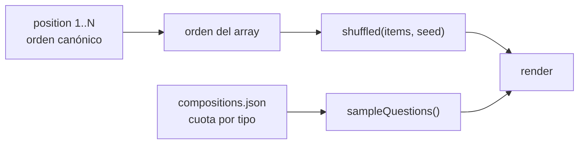
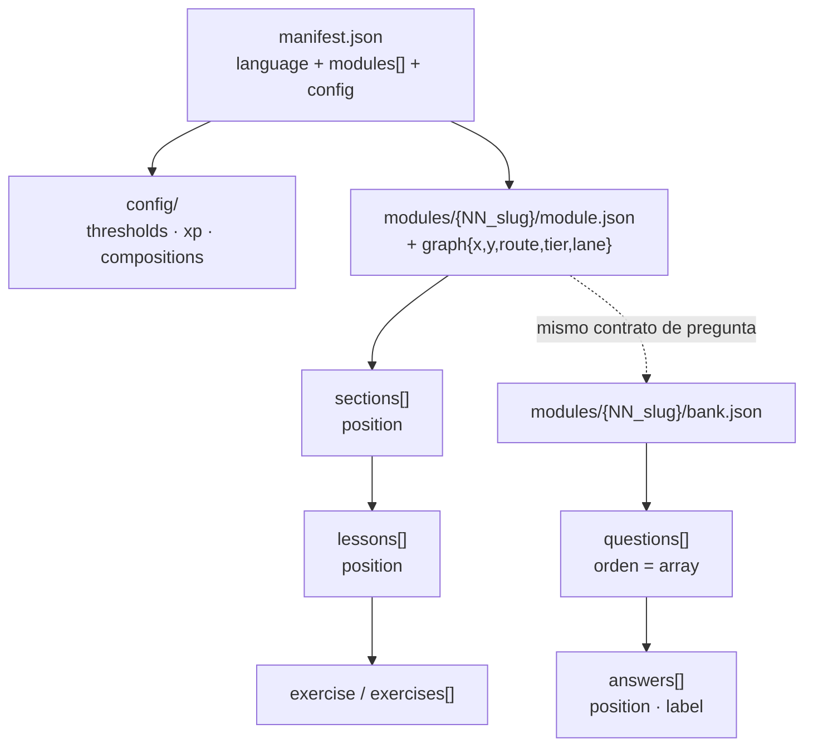
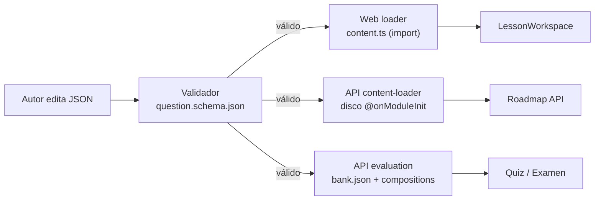
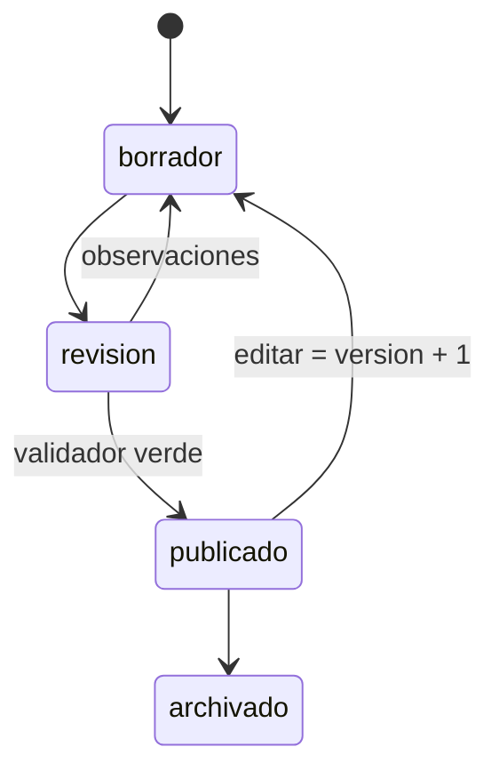
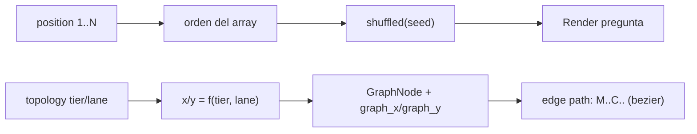

# 30 — Estructura del Roadmap y Coordenadas (Roadmap Structure & Coordinates)

> **Estado:** Vigente · **Versión del documento:** 1.0.0 · **Fecha:** 2026-10-15
> **Zona horaria:** America/Bogota (UTC-5)
> Documenta **el orden pedagógico** y **el sistema de coordenadas** del grafo de roadmap, y propone el bloque declarativo `graph` para `module.json`.
> Complementa a `29_QUESTION_JSON_CONTRACT.md` (orden de preguntas/respuestas), `14_LEARNING_SYSTEM.md` (jerarquía y desbloqueo) y `11_SYSTEM_ARCHITECTURE.md` (Content Engine).

---

## 1. Propósito

Responder tres preguntas para autores y editores de contenido:

1. ¿En qué orden se muestran módulos, secciones, lecciones, preguntas y respuestas?
2. ¿Dónde viven las coordenadas del grafo y cómo se calculan?
3. ¿Cómo se guarda la posición de un módulo en el roadmap sin tocar código?

---

## 2. Modelo de orden

### 2.1 Orden pedagógico (declarativo, `position` obligatorio)

| Nivel | Campo | Archivo | Validación |
|---|---|---|---|
| Lenguaje | `sort_order` | `manifest.json` | 1–999, único entre visibles |
| Módulo | `position` | `manifest.json → modules[]` | 1..N sin huecos por lenguaje |
| Módulo (capa curso) | `topology.tier` / `topology.lane` | `content/courses.json` | ver §3 |
| Sección | `position` | `module.json → sections[]` | 1..N sin huecos por módulo |
| Lección | `position` | `module.json → sections[].lessons[]` | 1..N sin huecos por sección |
| Pregunta (banco) | índice del array (o `position?`) | `bank.json` | sin huecos si se declara |
| Respuesta | índice de `answers[]` (o `position?`) | pregunta | sin huecos si se declara |
| Quiz / Examen | `compositions.json` (cuota por tipo) | `config/` | suma = total |

### 2.2 Orden de entrega (runtime)



- **Lecciones/secciones/módulos:** respetan `position`.
- **Preguntas y respuestas:** se **barajan** con `shuffled(items, seed)` (Fisher-Yates determinista) en `apps/web/src/lib/content.ts`; la evaluación usa `sampleQuestions()` en `apps/api/src/modules/evaluation/evaluation.service.ts`.
- **Consecuencia:** la clave se guarda por `id` (`correct_answer_ids`), nunca por índice. Ver `29` §6.

---

## 3. Sistema de coordenadas (3 capas)

El roadmap tiene **tres representaciones de la posición**, con distinto nivel de autoría:

| Capa | Formato | Fuente | Autoría |
|---|---|---|---|
| **A. Discreta (topológica)** | `topology: { tier, lane }` | `content/courses.json` | Autor de contenido (JSON) |
| **B. Derivada (fórmula)** | `x = tier·220 + 140`, `y = lane·130 + 290` | `get-roadmap-graph.use-case.ts` | Automática |
| **C. Curada (absoluta)** | `x`, `y` (viewBox 1150×620) + `route` | `apps/web/src/models/roadmap/**/*.mock.ts` ↔ MongoDB (`graph_x`, `graph_y`) | Curaduría visual |

### 3.1 Capa A — Discreta (topológica)

```json
{
  "slug": "python-3",
  "track_slug": "python",
  "topology": { "tier": 2, "lane": 0 },
  "prerequisites": ["python-2"],
  "edges": [
    {
      "target_course_slug": "fastapi-async",
      "connection_type": "unlocks",
      "visual_effect_code": "laser_flow_fast",
      "edge_color": "#8B5CF6"
    }
  ]
}
```

- `tier` = profundidad (eje X); `lane` = carril (eje Y). `lane` negativo = rama arriba, positivo = rama abajo.
- `edges[].connection_type`: `unlocks` (sólida) o `recommended` (punteada).
- `visual_effect_code` referencia `content/visual-effects.json`.

**Rejilla resultante:**

```
        lane -1        lane 0        lane 1
tier 0                  [py-1]
tier 1     [web-1]     [py-2]       [db-1]
tier 2                  [py-3]
tier 3     [fastapi]                 [django]
tier 4                  [apex]

    x = tier·220 + 140        y = lane·130 + 290
```

### 3.2 Capa B — Derivada (fórmula)

Definida en `apps/api/src/application/use-cases/curriculum/get-roadmap-graph.use-case.ts`:

```ts
const x = c.topology.tier * 220 + 140;
const y = c.topology.lane * 130 + 290;
```

Ejemplos: `(tier 0, lane 0) → (140, 290)` · `(tier 2, lane 0) → (580, 290)` · `(tier 3, lane 1) → (800, 420)`.

### 3.3 Capa C — Curada (absoluta)

Los grafos de módulos y secciones usan coordenadas absolutas dentro del `viewBox 1150×620`:

```jsonc
// apps/web/src/models/roadmap/tracks/lua-track.mock.ts
{
  "id": "lua-m03",
  "code": "03",
  "label": "OPERADORES",
  "x": 500, "y": 100,
  "route": "trunk",          // trunk | flow | data
  "variant": "locked",
  "iconType": "lock",
  "maxStars": 24, "xp": 480,
  "targetCourseId": "lua-operadores",
  "isUnlocked": false
}
```

- `route` soporta rutas multiruta (Lua: `trunk` → `flow` / `data`).
- El grafo de **secciones** reusa el mismo modelo con layout en zigzag (`lua-lessons-graph.mock.ts`, generado desde `module.json`).
- **Persistencia:** `roadmap-seed.helper.ts` convierte `GraphDataset` → filas con `graph_x`/`graph_y`, `variant`, `order_index` (`roadmap-db.types.ts`).

---

## 4. Propuesta: bloque `graph` en `module.json`

> [!IMPORTANT]
> Hoy `module.json` **no declara coordenadas**. El grafo de módulos de Lua vive hardcodeado en `lua-track.mock.ts` con la nota *"no editar a mano"*, y las secciones en `lua-lessons-graph.mock.ts`. Mover un módulo obliga a editar TypeScript, no JSON.

**Propuesta declarativa** (retrocompatible, opcional):

```jsonc
{
  "id": "lua_mod_03",
  "code": "LUA_MOD_03",
  "slug": "operadores",
  "position": 3,
  "graph": {
    "tier": 2,              // opcional: si existe, habilita el cálculo derivado
    "lane": 0,              // opcional
    "x": 500,               // opcional: coordenada absoluta curada
    "y": 100,               // opcional
    "route": "trunk"        // trunk | flow | data
  }
}
```

**Reglas de resolución** (para el futuro generador):

1. Si `graph.x`/`graph.y` existen → usar absolutas (capa C).
2. Si no, y `graph.tier`/`graph.lane` existen → derivar con la fórmula de §3.2.
3. Si no existe `graph` → derivar de `position` (tier = position - 1, lane = 0).

Esto permite: (a) editar posiciones por JSON, (b) regenerar `lua-track.mock.ts` automáticamente, (c) desacoplar la curaduría visual del código.

---

## 5. Visualización de la estructura

### 5.1 Jerarquía de archivos y entidades



### 5.2 Pipeline de la pregunta (autoría → runtime)



### 5.3 Ciclo de vida del contenido



### 5.4 Orden y coordenadas combinados



---

## 6. Tabla de equivalencias

| Concepto | `module.json` | `courses.json` | `*.mock.ts` / DB | Runtime |
|---|---|---|---|---|
| Orden del módulo | `position` | `topology.tier` | `order_index` | orden de lista |
| Carril | — | `topology.lane` | `y` | eje Y del grafo |
| Coordenada X | `graph.x` (propuesto) | `x = tier·220+140` | `graph_x` | `GraphNode.x` |
| Coordenada Y | `graph.y` (propuesto) | `y = lane·130+290` | `graph_y` | `GraphNode.y` |
| Ruta | `graph.route` (propuesto) | — | `route` | color de carril |
| Conexión | — | `edges[].target_course_slug` | `GraphConnection.fromId → toId` | path SVG |
| Estilo de arista | — | `edges[].connection_type` | `isDashed` | `unlocks` / `recommended` |
| Efecto visual | — | `edges[].visual_effect_code` | — | `content/visual-effects.json` |

---

## 7. Limitaciones conocidas

| # | Limitación | Impacto |
|---|---|---|
| L-01 | `getCourseRoadmap` filtra módulos por prefijo de id (`py_`, `js_`, `ts_`) | Lua no aparece en el roadmap del API |
| L-02 | `getLessonsGraph` tiene grafos hardcodeados por curso | Cambiar un módulo exige editar TS |
| L-03 | Los `*.mock.ts` de Lua se marcan "no editar a mano" pero no hay generador | Deriva entre contenido y grafo |
| L-04 | `content-loader.service.ts` lee disco una sola vez en `onModuleInit` | Sin watcher: editar requiere reiniciar |

> [!TIP]
> Las limitaciones L-01 a L-03 se resuelven con el bloque `graph` de §4 + un generador que regenere los `*.mock.ts` desde `content/`. L-04 se resuelve con un `fs.watch` sobre `content/`.

---

## 8. Trazabilidad

| Elemento | `14` | `23` | `29` | `11` |
|---|---|---|---|---|
| Orden pedagógico §2 | §2.1, §4 | §4.2–4.4 | §6 | — |
| Coordenadas §3 | — | §5 | — | §15 |
| Bloque `graph` §4 | §2.1 | §4.2 | — | §18 |
| Limitaciones §7 | §13 | §8 | §10.3 | — |

---

*Fin de `30_ROADMAP_STRUCTURE_AND_COORDINATES.md`. Cambios en el modelo de coordenadas o en el bloque `graph` requieren actualizar `content/schemas/question.schema.json`, `23`, `29` y el `CHANGELOG.md` con fecha `America/Bogota`.*
