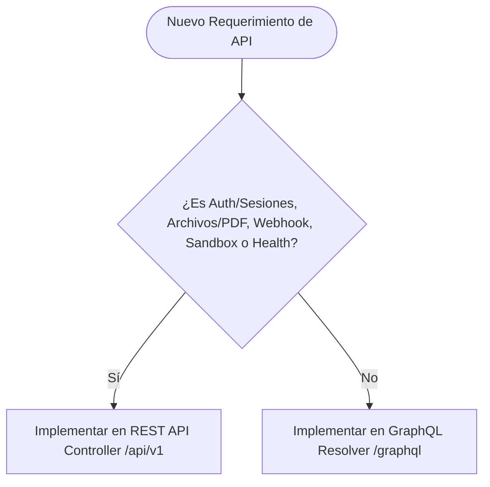

# ADR-012: Adopción de Arquitectura Híbrida GraphQL y REST en Backend NestJS

> **Estado:** Aprobado  
> **Fecha:** 2026-09-14  
> **Autores:** Daniel Echeverría & Equipo de Arquitectura Koda  
> **Trazabilidad:** `ADR-008`, `ADR-010`, `ADR-011`, `11_SYSTEM_ARCHITECTURE.md`, `13_API_SPECIFICATION.md`, `RNF-001`, `RNF-010`, `RNF-019`  

---

## 1. Contexto y Problema

A medida que Koda avanza en el desarrollo del frontend en Next.js 15 (`apps/web`) y enriquece la experiencia gamificada de aprendizaje (árbol de rutas DAG, dashboard de racha, inventario, progreso granular de módulos, logros y tablas de clasificación), se evidenciaron limitaciones al depender exclusivamente de una interfaz REST tradicional:

1. **Under-fetching y Red de Peticiones en Cascada (Waterfalls):** Vistas complejas como el *Dashboard Principal* o la vista de *Módulos y Lecciones* requieren consultar simultáneamente múltiples recursos independientes (`/api/v1/users/me`, `/api/v1/gamification/streak`, `/api/v1/progress/active-course`, `/api/v1/achievements/recent`). Esto provocaba de 3 a 5 peticiones HTTP secuenciales o paralelas, aumentando el tiempo total de renderizado y el consumo de ancho de banda en redes móviles.
2. **Over-fetching en Vistas Resumidas:** Componentes ligeros como la barra de navegación o widgets de perfil consumen endpoints REST completos que serializan campos innecesarios del documento o modelo relacional.
3. **Rigidez en la Evolución del Contrato Frontend-Backend:** Cada nueva pantalla compuesta demandaba la creación de endpoints específicos (*Backend for Frontend / BFF ad-hoc*) o el engrosamiento de los DTOs existentes, aumentando la deuda técnica.

Sin embargo, migrar la totalidad del backend a GraphQL presentaba serios inconvenientes: complejidad innecesaria para autenticación basada en tokens y cookies seguras, dificultad en la gestión de carga de archivos binarios (avatares y certificados), imposibilidad de usar webhooks estándar de terceros y pérdida del almacenamiento en caché HTTP/CDN nativo.

---

## 2. Alternativas Evaluadas

1. **Mantener REST API Pura (Status Quo):**
   - *Ventajas:* Simplicidad de desarrollo, convención universal HTTP, caché L1 en CDN directa y subida de archivos transparente.
   - *Desventajas:* Persistencia de problemas de under-fetching/over-fetching; proliferación de endpoints dedicados o sobrecargados; mayor latencia percibida en pantallas agregadas.

2. **Migración Total a GraphQL Puro:**
   - *Ventajas:* Un solo endpoint (`/graphql`), tipado estricto con GraphQL Code Generator, consultas declarativas y exactas.
   - *Desventajas:* Complejidad desmedida para flujos OAuth/Supabase Auth, streaming de ejecución de código, subida de archivos multipart, webhooks externos y auditorías de seguridad (riesgo de ataques DoS por queries anidadas/recursivas).

3. **Arquitectura Híbrida Pragmática (GraphQL + REST) en NestJS (Opción Elegida):**
   - *Ventajas:*
     - **Lo mejor de ambos mundos:** GraphQL actúa como capa de agregación y consulta flexible para las pantallas interactivas de usuario, mientras que REST retiene los flujos transaccionales, de identidad y de infraestructura.
     - **Coexistencia nativa en NestJS:** Tanto los `@Controller()` REST como los `@Resolver()` GraphQL invocan exactamente los mismos servicios de aplicación y repositorios hexagonales definidos en el dominio.
     - **Adopción gradual y controlada:** Se introduce GraphQL únicamente donde su valor compositivo supera la sobrecarga de implementación.
   - *Desventajas:* Mantenimiento de dos capas de transporte de entrada en el backend y necesidad de gobernanza técnica para evitar duplicidad desordenada.

---

## 3. Decisión Adoptada

Se aprueba formalmente la adopción de una **Arquitectura Híbrida GraphQL y REST**, bajo la directriz estricta de:
1. **Asignar a GraphQL (`/graphql`)** todas las vistas interactivas, consultas de currículo/roadmap, mutaciones de aprendizaje y **todas las operaciones clasificadas previamente como indiferentes/equivalentes** (catálogo de tracks, presets de efectos visuales, lenguajes, preferencias de estudio y metadatos de plataforma), con el fin de consolidar el contrato de consumo del cliente en una sola interfaz fuertemente tipada y declarativa.
2. **Reservar a REST (`/api/v1`)** de forma estricta y exclusiva las operaciones que requieren estándares HTTP nativos: autenticación y gestión de sesiones con cookies seguras, transferencia de archivos binarios, integración de webhooks externos, ejecución de sandbox y telemetría de infraestructura.

### Criterios Taxonómicos de Elección de Transporte:

### A. Casos Asignados a GraphQL (`/graphql`):
- **Curriculum y Contenido Modular (MongoDB):** Pistas de aprendizaje (`tracks`), cursos con topología DAG (`trackCourses`), detalle de curso con módulos/secciones (`courseDetail`), lecciones atómicas con tríada evaluativa (`lessonDetail`) y presets de efectos visuales acelerados por GPU (`visualEffects`).
- **Grafo DAG del Roadmap y Árbol de Carrera:** Nodos interactivos espaciales (coordenadas SVG), aristas de progresión y sembrado de datasets.
- **Pantallas Compuestas del Estudiante:** Dashboard de bienvenida, vista de perfil público, árbol de habilidades y lecciones, tablas de clasificación (*Leaderboards*).
- **Mutaciones de Interacción de Gamificación y Aprendizaje:** Envío y evaluación de respuestas de lección con feedback anti-spoilers, resolución de errores en el cuaderno (algoritmo SM-2), reclamo de logros y compra de ítems cosméticos.
- **Catálogos y Preferencias (Previamente Indiferentes):** Catálogo de lenguajes (`languages`), preferencias pedagógicas del estudiante y metas de estudio diario.

### B. Casos Asignados a REST (`/api/v1`):
- **Autenticación e Identidad:** Registro con OTP, verificación de sesión JWT, inicio de sesión, refresh tokens, flujos OAuth con Supabase/Google y sesiones seguras en cookies `httpOnly`.
- **Gestión de Archivos y Multimedia:** Carga de avatares a Supabase Storage, exportación/descarga de certificados oficiales PDF vía streaming con `Content-Disposition`.
- **Webhooks e Integraciones Externas:** Callbacks de pasarelas de pago (Stripe) con validación de firmas criptográficas en cabeceras HTTP.
- **Ejecución y Verificación de Código en Sandbox:** Endpoints de ejecución remota (`ICodeRunner`) con control de timeouts estrictos (2.5s) y streaming SSE de stdout/stderr.
- **Salud y Métricas de Infraestructura:** `/health`, `/metrics` (Prometheus), probes de Kubernetes y Docker.

### C. Estándares Técnicos de Implementación:
1. **Enfoque Code-First en NestJS:** Uso de `@nestjs/graphql` con Apollo Server. Los esquemas se derivan directamente de clases TypeScript decoradas con `@ObjectType()`, `@Field()`, `@InputType()`, garantizando compatibilidad con `@koda/types`.
2. **Prevención del Problema N+1:** Es obligatorio el uso del patrón **DataLoader** en los resolvers que resuelvan relaciones anidadas (ej. módulos por curso, lecciones por sección).
3. **Seguridad y Costo de Consultas:** Configuración obligatoria de `depthLimit` (máximo 5 niveles de profundidad) y validación de complejidad de query para neutralizar vectores de denegación de servicio.
4. **Coexistencia Hexagonal:** Los resolvers GraphQL (`presentation/graphql`) y controladores REST (`presentation/rest`) actúan como *Driving Adapters* desacoplados, invocando exactamente los mismos casos de uso de la capa `application/use-cases/`.

---

## 4. Consecuencias

- **Positivas:**
  - Reducción sustancial del número de peticiones HTTP en el arranque y navegación del frontend Next.js 15.
  - Tipado automático de extremo a extremo en el monorepo (Backend TypeScript $\rightarrow$ Schema $\rightarrow$ GraphQL Code Generator $\rightarrow$ React Hooks).
  - Preservación de la robustez, simplicidad y compatibilidad estándar de la capa de autenticación, archivos y webhooks en REST.
- **Trade-offs y Mitigaciones:**
  - **Doble superficie de transporte:** Se mitiga centralizando la lógica de negocio en la capa de aplicación/dominio hexagonal; los controladores y resolvers son meros adaptadores de entrada (*Driving Adapters*).
  - **Gestión de Caché:** GraphQL utilizará la caché normalizada del cliente (Apollo Client / URQL / TanStack Query) y Cache-Aside en Redis L2 en el backend, reservando la caché HTTP de borde (CDN) para los endpoints REST.
